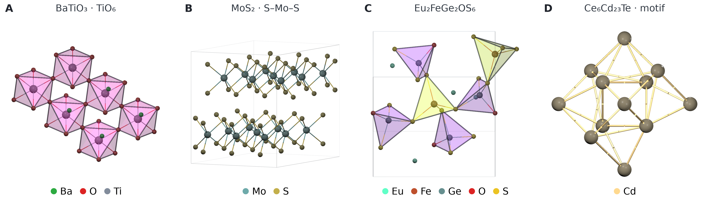

# Crystikz

English · [简体中文](README.zh-CN.md)

[](#installation)
[](LICENSE)

Crystikz is a Python library for reproducible crystal structure figures. Install it as
`crystalfig` and use it from Python, the command line, or YAML batch files. It turns
crystallographic structures into ball-and-stick networks, coordination polyhedra, and layered
views for papers and presentations.



## Features

- Read CIF, POSCAR, CSSR, JSON, and YAML files, or use pymatgen `Structure` and ASE `Atoms` objects.
- Choose a complete unit cell, supercell, local coordination shell, or connected motif. Automatic
  framing and view selection use the periodic geometry and bond graph.
- Export editable vector geometry or depth-buffered 3D images. Combine figures with vector
  panel labels, titles, and element legends in a hybrid PDF.

## Installation

Requires Python 3.10 or later and Git. Version 0.2.0 is a release candidate. Install from
GitHub while the PyPI release is pending.

```bash
python -m pip install "crystalfig @ git+https://github.com/future3317/Crystikz.git"
```

For PyVista/VTK rendering, including the 3D examples below:

```bash
python -m pip install "crystalfig[render3d] @ git+https://github.com/future3317/Crystikz.git"
```

The base package supports SVG, Matplotlib, and TikZ geometry. The `ase` and `reciprocal` extras
provide ASE and seekpath integration. TikZ-to-PDF compilation requires a LaTeX installation.
PDF preflight uses Poppler tools such as `pdfinfo` and `pdffonts`. Run `crystalfig doctor` to
inspect the local setup.

## Quick start

Draw silicon and export an SVG using a bundled structure. For your own structure, use
`CrystalFigure.from_file("structure.cif")` or pass a pymatgen structure to `from_structure()`.

```python
from crystalfig import CrystalFigure, DisplayConfig, FigureConfig, RenderConfig
from crystalfig.examples.presets import diamond_structure

silicon = CrystalFigure.from_structure(diamond_structure(conventional=True))
silicon.configure(FigureConfig(
    style="journal_clean",
    display=DisplayConfig(intent="network", framing="unit_cell"),
    render=RenderConfig(backend="svg", width_mm=89),
))
silicon.export("silicon.svg")
```

## Examples

### Coordination polyhedron

Render the complete TiO₆ shell from a periodic BaTiO₃ structure as a 600 DPI PNG. The
`center_ligand_only` policy emphasizes bonds in the displayed shell.

```python
from crystalfig import CrystalFigure, DisplayConfig, FigureConfig
from crystalfig.examples.presets import perovskite_structure

titanate = CrystalFigure.from_structure(perovskite_structure()).configure(FigureConfig(
    style="vesta_coordination",
    display=DisplayConfig(
        framing="local_coordination",
        centers=("Ti",),
        coordination_shell="complete",
        bond_display_policy="center_ligand_only",
    ),
))
titanate.export("tio6.png", width=89, dpi=600)
```

### Multipanel PDF

Place a coordination framework beside a layered structure. The hybrid backend embeds the
3D panels as images and preserves the titles and legends as vector text and marks.

```python
from crystalfig import CrystalFigure, DisplayConfig, FigureConfig, FigureGrid
from crystalfig.examples.presets import mos2_structure, perovskite_structure

oxide = CrystalFigure.from_structure(perovskite_structure()).configure(FigureConfig(
    display=DisplayConfig(intent="coordination", centers=("Ti",)),
    style="journal_vivid",
))
layered = CrystalFigure.from_structure(mos2_structure()).configure(FigureConfig(
    display=DisplayConfig(intent="layered"),
    style="layered_crystal",
))

grid = FigureGrid(rows=1, cols=2, backend="hybrid", width_mm=183, height_mm=64,
                  legend_mode="panel")
grid.add_structure(oxide, 0, 0, title="BaTiO₃")
grid.add_structure(layered, 0, 1, title="MoS₂")
grid.save("crystals.pdf", dpi=600)
```

The [preset showcase](gallery/publication_review/comparison_contact_sheet.png) uses each preset's
default composition and camera. The [controlled style benchmark](gallery/publication_review/controlled_style_benchmark.png)
holds atom positions and radii, bond connectivity, polyhedron geometry, and camera fixed so you can
compare appearance. See also the [bond and framing comparison](gallery/publication_review/coordination_comparison.png)
and [backend comparison](gallery/publication_review/backend_comparison.png).

## CLI and batch rendering

Replace `structure.cif` with your input file. The last two commands inspect the local
environment and the PDF created by the preceding multipanel example.

```bash
crystalfig inspect structure.cif
crystalfig render structure.cif -o structure.svg --backend svg --framing unit_cell
crystalfig render structure.cif -o detail.png --backend pyvista --style vesta_coordination --framing local_coordination --framing-site 0
crystalfig doctor
crystalfig preflight crystals.pdf
```

Save the following as `figures.yaml` and run `crystalfig batch figures.yaml`. The input and
output paths resolve relative to the YAML file.

```yaml
figures:
  - input: structure.cif
    output: figures/structure.svg
    style: journal_clean
    display:
      framing: unit_cell
    render:
      backend: svg
      width_mm: 89
```

## Rendering and scientific controls

| Backend | Output | Use case |
| --- | --- | --- |
| `svg` | SVG | Editable vector geometry |
| `matplotlib` | PDF, EPS, PGF, PNG, TIFF | Vector figures and Matplotlib integration |
| `tikz` | TeX/TikZ | LaTeX typesetting |
| `pyvista` | PNG, hybrid PDF | Depth-buffered 3D shading and translucent surfaces |

`DisplayConfig` controls framing, neighbor selection, and bond visibility. Use
`framing="local_coordination"` with a zero-based `framing_site` for a specific site's
neighborhood, or `region=(2, 2, 1)` for a supercell. Automatic motif framing prioritizes
element coverage within the atom budget and can include multiple components of the
inferred bond graph. Use `DisplayConfig(framing="motif", motif=MotifConfig(strict_species_coverage=True))`
to require coverage. Set `required_species` to target a subset of elements, select
`largest_component` for a connected fragment, or use `centered` with a zero-based
`seed_site` for a site-centered fragment. Read `build_scene().metadata["motif_coverage"]`
for the selected and missing elements. For mixed-occupancy sites, the renderer shows
the dominant element and coverage reports any positive-occupancy elements absent from the motif.
Motifs show selected atoms. Use `unit_cell` to show the full cell composition.
Coordination shells retain periodic ligand images by default.
Available bond policies are `all_bonds`, `center_ligand_only`, `polyhedron_edges_only`, and `hidden`.

Choose `journal_clean`, `journal_vivid`, `vesta_ballstick`, `vesta_coordination`, or
`layered_crystal`. Use `CameraConfig` for a fixed view and `crystalfig.styles.get_style()`
for independent control over the atom, bond, polyhedron, cell, and lighting settings.
Check inferred neighbors against the intended coordination when preparing a scientific figure.
Use a cutoff or manual neighbors when the default CrystalNN model is unsuitable.
If automatic `vesta_coordination` finds no valid polyhedra, scene metadata records the
requested style, effective ballstick style, center count, and fallback reason.

## Contributing

Use Python 3.11 for local development and validation. Report bugs and propose changes
through [GitHub Issues](https://github.com/future3317/Crystikz/issues). For a rendering issue,
include a minimal structure, the render command, and the backend.

```bash
git clone https://github.com/future3317/Crystikz.git
cd Crystikz
python -m pip install -e ".[dev,render3d]"
python -m ruff check .
python -m pytest tests -q
```

See the [changelog](CHANGELOG.md), [migration guide](MIGRATION.md), and
[release verification instructions](PUBLISHING.md). Regenerate the publication benchmark
with `python examples/generate_publication_review.py` using PyVista and Poppler.

## License and attribution

Crystikz is distributed under the [MIT License](LICENSE), copyright © 2026 AI4Materials Group.
Dataset and dependency attributions are listed in the [third-party notices](THIRD_PARTY_NOTICES.md).
