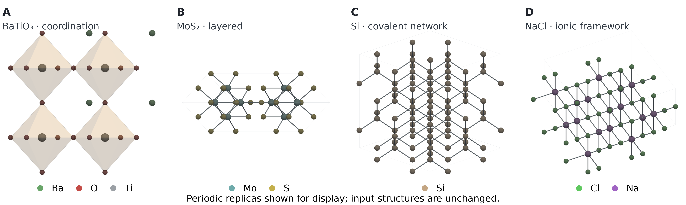

# crystalfig

**Publication-oriented crystal structure figures for Python.** `crystalfig` turns CIF files and
crystal structures into reusable ball-and-stick, coordination-polyhedron, layered, and unit-cell
visualizations. A shared structure and scene model feeds editable vector renderers and an optional
depth-buffered 3D renderer.



[View the complete 14-structure regression gallery](gallery/showcase/contact_sheet.png) · [before/after visual review](gallery/showcase/visual_review_before_after.png)


[](LICENSE)
[](https://github.com/future3317/Crystikz/actions/workflows/ci.yml)

## Install

```bash
python -m pip install "crystalfig @ git+https://github.com/future3317/Crystikz.git"
```

Version 0.2.0 is prepared but not yet published to PyPI. When the project is published there,
the installation command will become `python -m pip install crystalfig`.

Install optional integrations only when needed:

```bash
python -m pip install "crystalfig[render3d] @ git+https://github.com/future3317/Crystikz.git"  # PyVista/VTK
python -m pip install "crystalfig[ase] @ git+https://github.com/future3317/Crystikz.git"       # ASE
python -m pip install "crystalfig[reciprocal] @ git+https://github.com/future3317/Crystikz.git" # seekpath
python -m pip install "crystalfig[latex] @ git+https://github.com/future3317/Crystikz.git"     # PDF helpers
python -m pip install "crystalfig[all] @ git+https://github.com/future3317/Crystikz.git"       # all extras
```

The base installation includes CIF/POSCAR loading, pymatgen structures, Matplotlib and SVG
rendering. PyVista and VTK are intentionally optional because they add a large 3D runtime.

## Quick start

Render a CIF as an editable vector PDF:

```python
from crystalfig import CrystalFigure

figure = (
    CrystalFigure.from_file("BaTiO3.cif", theme="polyhedra_clean")
    .add_polyhedra(centers="Ti", strategy="crystalnn")
    .show_unit_cell()
)
result = figure.export("BaTiO3.pdf", width=89)
print(result.vector_status)  # "pure"
```

Use the same API with a pymatgen `Structure` or (with the `ase` extra) ASE `Atoms`:

```python
from pymatgen.core import Structure
from crystalfig import CrystalFigure

structure = Structure.from_file("BaTiO3.cif")
figure = CrystalFigure.from_structure(structure).quick()
figure.export("BaTiO3.svg", width=89)
```

`CrystalFigure` is reusable and backend-independent: adjust the cell, view, bonds, polyhedra,
style and annotations before exporting. For example, `view([1, 1, 0])` sets a crystallographic
view direction, while `supercell((2, 2, 1))` expands the displayed structure.

For an unknown structure, let the display planner choose a network, coordination, layered, ionic,
or minimal view. It selects a finite periodic display window without changing the input structure,
keeps coordination shells complete by default, and optimizes the camera for the resulting scene:

```python
figure = CrystalFigure.from_file("unknown_material.cif").publication(
    intent="auto", region="auto", coordination_shell="complete", camera="optimize"
)
figure.export("structure.svg", backend="svg", width=89)
figure.export("structure.png", backend="pyvista", width=89, dpi=600, transparent=True)
```

`publication()` uses `CrystalNN` candidate neighbors by default; automatic neighbors are a display
model, not a unique chemical bond assignment. Override the general intent with `network`,
`coordination`, `layered`, `ionic`, or `minimal`. Set `centers=[...]` to choose coordination sites
explicitly. `coordination_shell="complete"` keeps real periodic ligand vertices even outside the
displayed cell; `show_partial` opts into clipped geometry and marks its artificial cut faces.

Create a polyhedron-led view when coordination is the intended scientific message:

```python
from crystalfig import CrystalFigure, FigureGrid

figure = CrystalFigure.from_file("structure.cif").publication(
    intent="coordination",
    coordination_shell="complete",
    palette="publication",
    camera="optimize",
    background="white",
)
figure.save("structure.svg")  # PNG and PDF are also supported
```

Automatic intent and center selection are geometry/chemistry heuristics, not a chemical assignment;
the chosen strategy and any fallback are recorded in diagnostics and scene metadata. The scene
metadata distinguishes the camera actually used from the recommended candidates. The legacy
`boundary="cell"` option remains available for explicitly clipped views; the new complete-shell
policy does not clip a coordination polyhedron to the cell.

Compose multiple structures with a shared Matplotlib figure:

```python
grid = FigureGrid(
    rows=1, cols=2, panel_labels=True, backend="hybrid",
    width_mm=183, height_mm=70, legend_mode="panel",
)
grid.add_structure(CrystalFigure.from_file("phase-a.cif"), 0, 0, title="Phase A", intent="auto")
grid.add_structure(CrystalFigure.from_file("phase-b.cif"), 0, 1, title="Phase B", intent="auto")
grid.save("phases.pdf", dpi=300)
```

`FigureGrid` supports `vector`, `pyvista`, and `hybrid` structure panels. Hybrid panels rasterize
the depth-buffered PyVista scene and keep panel labels, titles, legends, and captions as vector
overlays in the fixed-size output. `grid.last_export_metadata["vector_status"]` reports whether
the saved document is pure vector, hybrid, or raster.

## Choose an output backend

| Backend | Formats | Output | Use it for |
| --- | --- | --- | --- |
| `matplotlib` (default) | PDF, EPS, PGF, PNG, TIFF | Vector for PDF/EPS/PGF; raster for PNG/TIFF | Conventional paper figures and Matplotlib integration |
| `svg` | SVG | Editable vector | Editing paths and labels in a vector graphics editor |
| `tikz` | TEX/TIKZ | LaTeX drawing commands | Figures that should use the paper's LaTeX fonts |
| `pyvista` (optional) | PNG | High-resolution raster with 3D depth buffering | Complex 3D structures and mesh occlusion |
| `matplotlib3d` | PDF, SVG, EPS, PGF, PNG, TIFF | Projected 3D preview; hybrid for vector formats | Previewing the legacy Matplotlib 3D projection |

Select a backend explicitly when needed. The default backend is chosen from the output extension.

```python
figure.export("BaTiO3.png", backend="pyvista", width=89, dpi=600)
figure.export("BaTiO3.svg", backend="svg", width=89)
hybrid = figure.export_hybrid_pdf("BaTiO3-hybrid.pdf", width=89, dpi=600)
print(hybrid.vector_status)  # "hybrid": 3D image plus vector annotations
```

The SVG, TikZ, and Matplotlib vector paths are useful for editable figures. PyVista exports PNG;
`export_hybrid_pdf()` embeds its high-resolution image in a PDF with vector annotations. A hybrid
or raster result is not a pure-vector figure. PyVista requires a working VTK off-screen rendering
environment; unsupported transparency/depth-peeling capabilities are reported by the renderer.

## Styles and views

Built-in semantic themes provide starting points for common figure types:

```python
figure = (
    CrystalFigure.from_file("MoS2.cif", theme="layered_clean")
    .add_bonds(strategy="crystalnn")
    .view_preset("layer_oblique")
)
figure.export("MoS2.png", backend="pyvista", width=89, dpi=600)
```

Themes: `nature`, `ballstick_clean`, `polyhedra_clean`, `layered_clean`, `overview_minimal`, plus
the `publication` family. View presets include `auto`, `isometric`, `along_a`, `along_b`, `along_c`,
`front`, `side`, `top`, `layer_top`, `layer_oblique`, and `polyhedron_focus`. Presets are editable defaults; the final
figure still depends on the structure, selected neighbors, view, labels and export size.

## Command line

```bash
crystalfig render BaTiO3.cif -o BaTiO3.pdf --bonds crystalnn --polyhedra Ti --width 89
crystalfig inspect BaTiO3.cif
crystalfig doctor
crystalfig preflight BaTiO3.pdf
```

`crystalfig render --help` lists rendering options. The Python API also supports YAML batch
rendering with `crystalfig batch figures.yaml`. Batch paths are relative to the YAML file:

```yaml
figures:
  - input: structures/sample.cif
    output: figures/sample.svg
    backend: svg
    style: ballstick_clean
    width: 89
    height: 65
    dpi: 300
    quality: standard
    view_preset: auto
    show_axes: false
    show_cell: true
    bonds:
      strategy: crystalnn
```

## Capabilities

- Read CIF, POSCAR, CSSR, JSON and YAML structures; accept pymatgen `Structure` and optional ASE
  `Atoms` objects.
- Build conventional/primitive cells, supercells, periodic images, bonds, coordination polyhedra,
  Miller-plane intersections and basic Brillouin-zone geometry.
- Style atoms, bonds and sites; add vectors and labels; draw into an existing Matplotlib axes.
- Export at figure widths specified in millimetres, with configurable DPI and transparent
  backgrounds where supported by the selected renderer.
- Inspect the curated [four-panel hybrid figure](gallery/showcase/paper_four_panel.png), the
  [14-structure diagnostic showcase](gallery/showcase/contact_sheet.png), the
  [baseline diagnostic sheet](gallery/baseline/contact_sheet.png), and the
  [rendered format comparisons](gallery/showcase/).

## Scientific and rendering notes

Bond detection depends on the selected strategy and input structure; it is not a universal
chemical-bond assignment. Check coordination and periodic images for the material and use case.
Vector renderers use projected drawing order and cannot provide full per-pixel 3D occlusion for
intersecting transparent geometry. Use PyVista for depth-buffered 3D output when that distinction
matters. PyVista output is raster; use SVG, TikZ or Matplotlib when editable vector geometry is
required.

`crystalfig` complements crystallographic editors such as VESTA, atomistic analysis tools such as
OVITO, and general 3D software such as Blender. It focuses on repeatable Python figure generation
from crystal structure data.

## Development

```bash
git clone https://github.com/future3317/Crystikz.git
cd Crystikz
python -m pip install -e '.[dev]'
python -m pytest tests -q
python -m ruff check crystalfig tests examples
python -m build --wheel
```

For the release candidate wheel install, CLI, and export smoke checks, run
`python scripts/check_release.py`. See [PUBLISHING.md](PUBLISHING.md) for the v0.2.0 release
checklist and current PyPI status.

## License

MIT. See [LICENSE](LICENSE).
