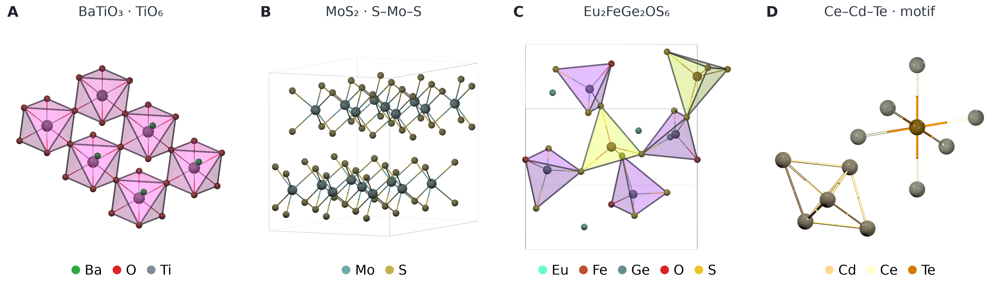

# Crystikz

[English](README.md) · 简体中文

[](#安装)
[](LICENSE)

Crystikz 是一个用于生成可复现晶体结构图的 Python 库，安装和导入名称为 `crystalfig`。
支持 Python、命令行和 YAML 批处理，可生成适合论文与报告的球棍网络、配位多面体和层状结构图。



## 主要功能

- 读取 CIF、POSCAR、CSSR、JSON 和 YAML，也可直接使用 pymatgen `Structure` 或 ASE `Atoms` 对象。
- 支持完整晶胞、超胞、局部配位壳和连通结构片段。自动构图和选角依据周期几何与键图。
- 输出可编辑的矢量几何或带深度遮挡的三维图像。可合成多面板混合 PDF，保留矢量面板标记、标题和元素图例。

## 安装

需要 Python 3.10 或以上版本以及 Git。当前 0.2.0 为候选版本，PyPI 发布前可从 GitHub 安装。

```bash
python -m pip install "crystalfig @ git+https://github.com/future3317/Crystikz.git"
```

三维渲染和下文的三维示例需要 PyVista/VTK，可安装 `render3d` 扩展。

```bash
python -m pip install "crystalfig[render3d] @ git+https://github.com/future3317/Crystikz.git"
```

基础包提供 SVG、Matplotlib 和 TikZ 渲染。`ase` 和 `reciprocal` 扩展分别提供 ASE 与 seekpath
集成。将 TikZ 编译成 PDF 需要 LaTeX。PDF 预检使用 `pdfinfo` 和 `pdffonts` 等 Poppler 工具。
用 `crystalfig doctor` 检查本机环境。

## 快速开始

用内置的硅结构生成 SVG。若使用自己的结构文件，可调用 `CrystalFigure.from_file("structure.cif")`，
也可将 pymatgen 结构直接传给 `from_structure()`。

```python
from crystalfig import CrystalFigure, DisplayConfig, FigureConfig, RenderConfig
from crystalfig.examples.presets import diamond_structure

silicon = CrystalFigure.from_structure(diamond_structure(conventional=True))
silicon.configure(FigureConfig(
    style="journal_clean",
    display=DisplayConfig(intent="network", framing="unit_cell"),
    render=RenderConfig(backend="svg", width_mm=89),
))
silicon.export("silicon.svg")
```

## 使用示例

### 配位多面体

从周期 BaTiO₃ 结构中选取完整的 TiO₆ 配位壳，导出 600 DPI PNG。`center_ligand_only`
在图中突出所显示配位壳的中心到配体键。

```python
from crystalfig import CrystalFigure, DisplayConfig, FigureConfig
from crystalfig.examples.presets import perovskite_structure

titanate = CrystalFigure.from_structure(perovskite_structure()).configure(FigureConfig(
    style="vesta_coordination",
    display=DisplayConfig(
        framing="local_coordination",
        centers=("Ti",),
        coordination_shell="complete",
        bond_display_policy="center_ligand_only",
    ),
))
titanate.export("tio6.png", width=89, dpi=600)
```

### 多面板 PDF

将配位框架和层状结构并排展示。混合后端将三维面板嵌入 PDF，标题和图例保留为矢量文字和图形。

```python
from crystalfig import CrystalFigure, DisplayConfig, FigureConfig, FigureGrid
from crystalfig.examples.presets import mos2_structure, perovskite_structure

oxide = CrystalFigure.from_structure(perovskite_structure()).configure(FigureConfig(
    display=DisplayConfig(intent="coordination", centers=("Ti",)),
    style="journal_vivid",
))
layered = CrystalFigure.from_structure(mos2_structure()).configure(FigureConfig(
    display=DisplayConfig(intent="layered"),
    style="layered_crystal",
))

grid = FigureGrid(rows=1, cols=2, backend="hybrid", width_mm=183, height_mm=64,
                  legend_mode="panel")
grid.add_structure(oxide, 0, 0, title="BaTiO₃")
grid.add_structure(layered, 0, 1, title="MoS₂")
grid.save("crystals.pdf", dpi=600)
```

[预设展示](gallery/publication_review/comparison_contact_sheet.png)采用各预设默认的构图和视角。
[受控样式对照](gallery/publication_review/controlled_style_benchmark.png)固定原子位置和半径、键连接、
多面体几何和相机，用于比较样式。另见[键线和取景对比](gallery/publication_review/coordination_comparison.png)
及[后端对比](gallery/publication_review/backend_comparison.png)。

## 命令行与批处理

用自己的结构文件替换 `structure.cif`。最后两条命令分别检查本机环境和上方多面板示例生成的 PDF。

```bash
crystalfig inspect structure.cif
crystalfig render structure.cif -o structure.svg --backend svg --framing unit_cell
crystalfig render structure.cif -o detail.png --backend pyvista --style vesta_coordination --framing local_coordination --framing-site 0
crystalfig doctor
crystalfig preflight crystals.pdf
```

将下列配置保存为 `figures.yaml`，运行 `crystalfig batch figures.yaml`。
输入与输出路径都相对于 YAML 文件所在目录解析。

```yaml
figures:
  - input: structure.cif
    output: figures/structure.svg
    style: journal_clean
    display:
      framing: unit_cell
    render:
      backend: svg
      width_mm: 89
```

## 渲染后端与科学参数

| 后端 | 输出格式 | 用途 |
| --- | --- | --- |
| `svg` | SVG | 可编辑的矢量几何 |
| `matplotlib` | PDF、EPS、PGF、PNG、TIFF | 矢量出图与 Matplotlib 集成 |
| `tikz` | TeX/TikZ | LaTeX 排版 |
| `pyvista` | PNG、混合 PDF | 带深度遮挡的三维光照和半透明表面 |

用 `DisplayConfig` 配置取景、邻居策略和键线。`framing="local_coordination"` 可与从 0 开始的
`framing_site` 一起使用，显示指定原子位点的配位环境。`region=(2, 2, 1)` 可选取超胞。
自动 motif 取景优先在原子预算内覆盖元素，可以从推断键图的多个连通分量选取真实片段。
使用 `DisplayConfig(framing="motif", motif=MotifConfig(strict_species_coverage=True))` 要求元素覆盖，
也可以用 `required_species` 指定需要覆盖的元素。`largest_component` 只取一个连通片段，
`centered` 与从 0 开始的 `seed_site` 配合选取指定中心附近的片段。
`build_scene().metadata["motif_coverage"]` 提供已选和缺失的元素。混合占位按主占位元素绘制，
覆盖报告会列出有正占有率但未出现在 motif 中的元素。
motif 展示选取的原子，完整晶胞组成请用 `unit_cell` 展示。配位壳默认保留配体的周期镜像。
可用的键线策略有 `all_bonds`、`center_ligand_only`、`polyhedron_edges_only` 和 `hidden`。

可选预设包括 `journal_clean`、`journal_vivid`、`vesta_ballstick`、`vesta_coordination`
及 `layered_crystal`。使用 `CameraConfig` 固定视角，使用 `crystalfig.styles.get_style()`
分别调整原子、键、多面体、晶胞和光照参数。论文出图前请按研究目标核对推断的配位关系。
如果默认的 CrystalNN 邻居模型不适合该结构，可指定距离截断或手动邻居。
自动 `vesta_coordination` 未生成有效多面体时，场景元数据会记录请求样式、实际采用的球棍样式、
配位中心数量和回退原因。

## 参与贡献

本地开发和验证使用 Python 3.11。可以在 [GitHub Issues](https://github.com/future3317/Crystikz/issues)
报告问题或提出建议。报告渲染问题时，请附上最小结构样本、渲染命令及使用的后端。

```bash
git clone https://github.com/future3317/Crystikz.git
cd Crystikz
python -m pip install -e ".[dev,render3d]"
python -m ruff check .
python -m pytest tests -q
```

参阅[变更日志](CHANGELOG.md)、[迁移指南](MIGRATION.md)和[发布验证说明](PUBLISHING.md)。
安装 PyVista 和 Poppler 后，运行 `python examples/generate_publication_review.py` 可重新生成论文图库。

## 开源许可证与来源

Crystikz 采用 [MIT 许可证](LICENSE)。版权所有 © 2026 AI4Materials Group。
示例数据和依赖的来源见[第三方声明](THIRD_PARTY_NOTICES.md)。
